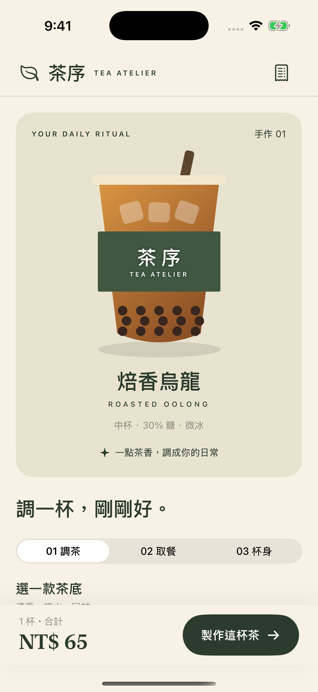
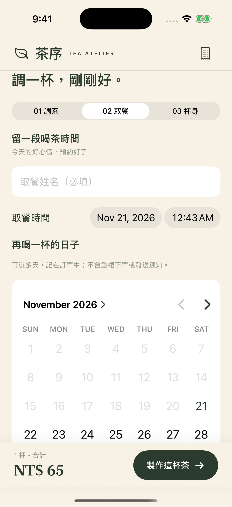
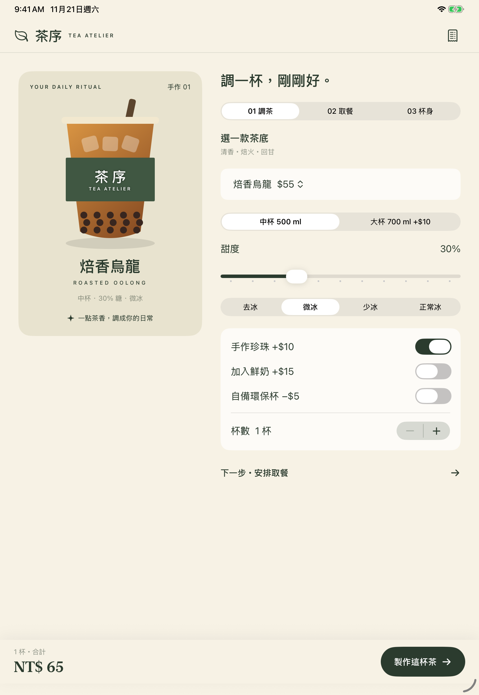

# 茶序 Tea Atelier

[GitHub 專案](https://github.com/Heisenbuwga/iosHW6)

SwiftUI 作業 #233：結合各種輸入元件 & 顯示 alert 的 App。
以奶油色紙張、墨綠杯標與程式繪製的茶杯，完成一杯專屬手搖茶。

## 執行

使用 Xcode 開啟 `iosHW6.xcodeproj`，選擇 `iosHW6` scheme 與 iPhone 或 iPad，按 ⌘R。最低 iOS 18，不需外部套件、API key 或網路；iCloud 照片可能需要下載。

## 功能與元件

| SwiftUI 元件 | 實際用途 |
| --- | --- |
| TextField | 必填取餐姓名 |
| Slider | 0～100% 甜度，每次 10% |
| Toggle | 珍珠、鮮奶、自備杯折扣 |
| Picker | 茶底選單、杯型、冰量、製作步驟 |
| DatePicker | 未來取餐日期與時間 |
| MultiDatePicker | 收藏想喝茶的日期，列入訂單，不發通知或重複下單 |
| Stepper | 1～12 杯，即時更新總額 |
| TextEditor | 給茶師的備註 |
| contextMenu | 長按茶杯，重設配方或移除照片 |
| alert | 必填／過期時間驗證、送出確認、完成、重設、照片錯誤 |
| PhotosPicker | 從系統照片選擇器挑選杯身圖案（題目的 PhotoPicker） |
| ColorPicker | 自訂杯標顏色 |

價格公式：`(茶底 + 大杯10 + 珍珠10 + 鮮奶15 − 自備杯5) × 杯數`，各選項依是否啟用計算。
訂單確認後透過 Codable + AppStorage 保留最近 30 筆，重新啟動仍可查看。杯身照片與顏色僅用於當次預覽，不寫入訂單。

這是課堂模擬點餐，不會付款、向店家送單或發送通知。

## 結構

- `ContentView.swift`：三步驟表單、資料綁定、alert、照片載入與本機紀錄。
- `Models/TeaOrder.swift`：配方價格、輸入驗證、可儲存的 Receipt。
- `Views/TeaCupView.swift`：SwiftUI Shape 茶杯、配料與杯標預覽。
- `Verification`：價格與驗證檢查、圖示產生器、示範錄製腳本。
- `Submission/Medium`：文章草稿與發布說明。
- `Demo`：模擬器截圖與影片。

## 驗證

執行 `sh Verification/verify-model.sh`，涵蓋 576 種價格組合、空白姓名、過期取餐時間及訂單 JSON 往返。
示範影片使用 Debug 專用 `-demo` 自動更新同一組表單狀態及訂單方法，並非手指點擊錄影。一般啟動不會執行示範。`-schedule` 與 `-review` 為截圖入口。

## 素材

茶杯以 SwiftUI Shape 繪製；App Icon 由 `Verification/make-icon.swift` 繪製；介面符號使用 Apple SF Symbols，沒有第三方圖片。

## 展示

- [iPhone 示範影片](Demo/TeaAtelier-iPhone-demo.mp4)
- [iPad 示範影片](Demo/TeaAtelier-iPad-demo.mp4)
- [Medium 文章預覽](Submission/Medium/Medium文章預覽.html)
